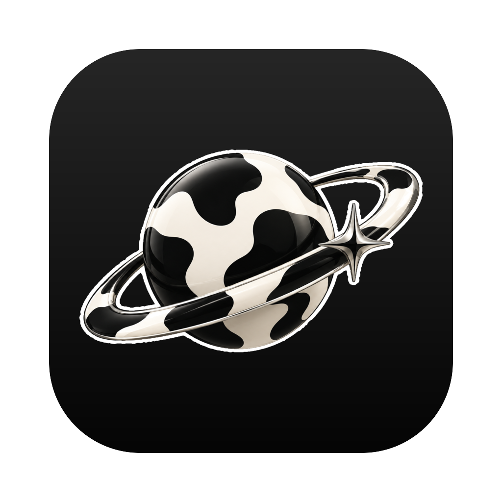

<p align="center">
  
</p>

<h1 align="center">Grazer</h1>

<p align="center"><b>A keyboard-first browser for macOS. Vim keys, one fuzzy palette, real WebKit.</b></p>

No tab strip, no address bar. `o` opens a palette that fuzzy-searches your open
tabs, saved places and history, and previews tabs live as you move through
them. Everything else is a key away.

## Keys

| Key | Action | Key | Action |
|---|---|---|---|
| `j` `k` `d` `u` | Scroll | `o` `t` `⌘L` | Palette |
| `gg` `G` | Top / bottom | `J` `K` | Previous / next tab |
| `H` `L` | Back / forward | `x` | Close tab |
| `f` | Link hints | `b` | Save as a place |
| `/` `n` `N` | Find | `r` | Reload |

In the palette: `^J`/`^K` move, `Enter` goes, `Esc` returns to where you were,
`^S` saves a place, `^X` closes or forgets.

## Also

- Tabs come back on relaunch.
- Publishes its tabs to [Rudder](https://github.com/jamierpond/Rudder), so any
  tab is one search away from anywhere.
- The binary is its own CLI: `Grazer --list-open-tabs`, `--focus-tab 3`,
  `--open-url github.com`.

## Build

Needs CMake 3.31+, Ninja, Node.js and [just](https://github.com/casey/just).

```sh
just run       # build and launch
just install   # Release build into /Applications
just icon      # regenerate Assets/Icon from Source.png
```

Some WebView APIs Grazer uses haven't landed on
[eacp](https://github.com/jamierpond/eacp) `main` yet; build against a local
checkout with `-DCPM_eacp_SOURCE=$HOME/path/to/eacp`.
